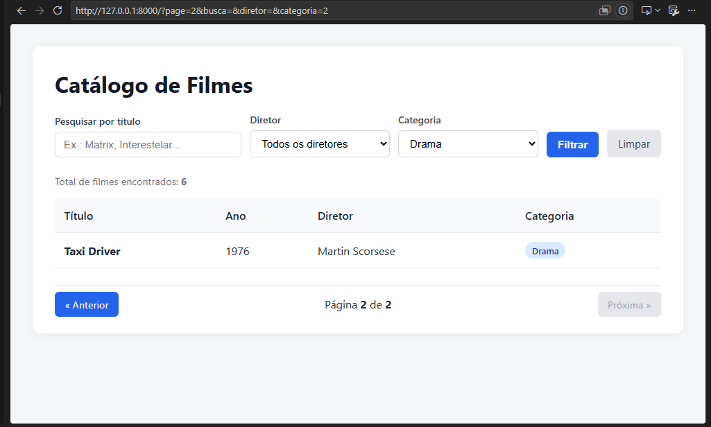

# CineCatálogo — Catálogo de Filmes em Django

Aplicação web desenvolvida em Python e Django para consulta, pesquisa, filtragem dinâmica e paginação de registros de filmes.

## Integrantes da Dupla
* Emanuel Dante
* Matheus Emmanuel

## Tema Escolhido
**Tema 2 — Catálogo de Filmes** (Modelos: `Filme`, `Diretor` e `Categoria`).

## Funcionalidades e Filtros Implementados
* **Pesquisa Textual (`busca`):** Filtra filmes pelo título utilizando consulta ORM `titulo__icontains` (insensível a maiúsculas/minúsculas).
* **Filtro por Diretor (`diretor`):** Campo `<select>` que filtra os filmes associados ao diretor selecionado via `ForeignKey`.
* **Filtro por Categoria (`categoria`):** Campo `<select>` que filtra os filmes pertencentes à categoria selecionada via `ForeignKey`.
* **Combinação e Paginação:** Os filtros funcionam individualmente ou combinados via método `GET`, exibindo **5 registros por página** (`Paginator`) e preservando os parâmetros selecionados na URL durante a navegação entre páginas.

## Como Executar o Projeto
1. Clone o repositório e crie um ambiente virtual:
   ```bash
   python -m venv venv
   source venv/bin/activate  # No Windows: venv\Scripts\activate

Instale o Django e aplique as migrações:
Bash
pip install -r requirements.txt
python manage.py migrate


Inicie o servidor:
Bash
python manage.py runserver

## Demonstração

